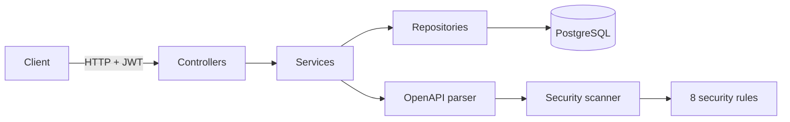

# API Sentinel

[](https://github.com/Skantzourakis/API-Sentinel/actions/workflows/ci.yml)

**Static security analysis for REST APIs.** Upload an OpenAPI (Swagger) specification
and API Sentinel reports security weaknesses mapped to the
[OWASP API Security Top 10](https://owasp.org/API-Security/), with a risk score,
severity summary and a comparison against the previous scan.

The scanner reads only the specification, so it never sends traffic to the API
being analysed.

## Features

- **8 deterministic security rules** covering authentication, object-level
  authorization, sensitive data in URLs, pagination, transport security and
  error contracts
- **Risk score and severity summary** for every scan
- **Paginated, filterable findings**, most severe first
- **Scan comparison**: new findings, resolved findings and risk score change
  between two versions of a specification
- **Scan history** per project, including scans of invalid files recorded as `FAILED`
- **User accounts with JWT authentication**; each user only sees their own data
- **Swagger UI** for exploring and trying the API

## Tech Stack

| Area | Technology |
|------|------------|
| Language / framework | Java 21, Spring Boot 3.5 (Web, Data JPA, Validation) |
| Security | Spring Security, OAuth2 Resource Server (JWT, HS256), BCrypt |
| Database | PostgreSQL 16, Flyway migrations, Hibernate |
| OpenAPI | swagger-parser (input), springdoc-openapi (own docs) |
| Testing | JUnit 5, AssertJ, MockMvc, H2 |
| Delivery | Docker (multi-stage build), Docker Compose, GitHub Actions |

## Architecture



- **Controllers** handle HTTP and map requests to DTOs; they contain no business logic.
- **Services** hold the logic and transaction boundaries.
- **Repositories** use Spring Data JPA, with JPQL for aggregation and ordering.
- **Scanner** is independent of HTTP and the database. Each rule is a Spring bean
  implementing `SecurityRule` (per endpoint) or `ApiSpecRule` (whole specification),
  so adding a rule means adding one class.

```text
backend/src/main/java/com/apisentinel
├── controller   REST endpoints
├── service      business logic
├── repository   Spring Data JPA repositories
├── entity       JPA entities
├── dto          request and response objects
├── scanner      OpenAPI parser, scanner and rules
├── security     Spring Security and JWT configuration
├── config       OpenAPI (Swagger) configuration
└── exception    error types and global error handling
```

## Quick Start

Requires Docker.

```bash
docker compose --profile app up -d --build
```

- API: `http://localhost:8080`
- Swagger UI: `http://localhost:8080/swagger-ui.html`

### Try it

```bash
# 1. Create an account and log in
curl -X POST localhost:8080/api/auth/register -H "Content-Type: application/json" \
     -d '{"email":"demo@example.com","password":"supersecret1"}'
curl -X POST localhost:8080/api/auth/login -H "Content-Type: application/json" \
     -d '{"email":"demo@example.com","password":"supersecret1"}'
# -> {"accessToken":"<token>","tokenType":"Bearer","expiresIn":3600}

# 2. Create a project and scan the included sample specification
curl -X POST localhost:8080/api/projects -H "Authorization: Bearer <token>" \
     -H "Content-Type: application/json" -d '{"name":"Sample Banking API"}'
curl -X POST localhost:8080/api/projects/1/scans/upload -H "Authorization: Bearer <token>" \
     -F "file=@backend/sample-openapi.yaml"

# 3. Read the results
curl localhost:8080/api/scans/1/summary -H "Authorization: Bearer <token>"
```

```json
{
  "scanId": 1,
  "status": "COMPLETED",
  "riskScore": 96,
  "endpointCount": 6,
  "totalFindings": 14,
  "findingsBySeverity": { "CRITICAL": 1, "HIGH": 6, "MEDIUM": 3, "LOW": 4 }
}
```

`backend/sample-openapi.yaml` triggers every rule and contains one endpoint
(`GET /transactions`) that passes all of them.

## Security Rules

| Rule | Severity | Checks | OWASP API Top 10 |
|------|----------|--------|------------------|
| `ADMIN_WITHOUT_AUTH` | CRITICAL | Admin path without declared security | API2 Broken Authentication |
| `UNAUTHENTICATED_WRITE` | HIGH | POST/PUT/PATCH/DELETE without declared security | API2 Broken Authentication |
| `POTENTIAL_BOLA` | HIGH | Object identifier in path without declared security | API1 Broken Object Level Authorization |
| `SENSITIVE_DATA_IN_QUERY` | HIGH | Passwords, tokens or keys in query parameters | API3 Broken Object Property Level Authorization |
| `INSECURE_SERVER_URL` | HIGH | Server declared over plain HTTP | API8 Security Misconfiguration |
| `MISSING_PAGINATION` | MEDIUM | Endpoint returning a list (or an undescribed response) without limit/page/cursor parameters | API4 Unrestricted Resource Consumption |
| `MISSING_REQUEST_BODY_SCHEMA` | MEDIUM | Write endpoint that declares neither a request body nor parameters | API8 Security Misconfiguration |
| `MISSING_ERROR_RESPONSES` | LOW | Operation documents no 4xx or default response | API8 Security Misconfiguration |

The parser follows the OpenAPI rule that operation-level `security` overrides the
global setting, so an operation declaring `security: []` is treated as public.

## Risk Score

The score runs from 0 to 100. The most severe finding decides the band, and each
finding then adds a little within it (critical 8, high 4, medium 2, low 1, halved):

| Most severe finding | Score band |
|---------------------|------------|
| Critical | 75–100 |
| High | 50–74 |
| Medium | 25–49 |
| Low | 5–24 |
| None | 0 |

So a long list of medium findings can never outrank a single critical one. An
earlier version simply added up weights and capped the total at 100, which gave
the Spotify Web API (36 medium findings, no high or critical) the same 100 as an
API with an unauthenticated admin endpoint.

## API

All endpoints except `/api/auth/**` require `Authorization: Bearer <token>`.

```http
POST   /api/auth/register
POST   /api/auth/login
GET    /api/users/me

POST   /api/projects
GET    /api/projects
GET    /api/projects/{id}
PUT    /api/projects/{id}
DELETE /api/projects/{id}

POST   /api/projects/{projectId}/scans/upload
GET    /api/projects/{projectId}/scans
GET    /api/scans/{scanId}
GET    /api/scans/{scanId}/findings?severity=&page=&size=
GET    /api/scans/{scanId}/summary
GET    /api/scans/{scanId}/comparison?baseScanId=
```

Errors use one JSON shape:

```json
{ "status": 404, "error": "Resource not found", "details": ["Scan with id 42 was not found"], "timestamp": "..." }
```

## Design Decisions

- **Deterministic rules, no AI verdicts.** Findings are reproducible and explainable.
  AI may later be used to explain findings, never to decide them.
- **Ownership returns `404`, not `403`.** Another user's project looks exactly like a
  missing one, so ids cannot be probed (protection against BOLA, the issue the
  scanner itself looks for).
- **Stateless JWT authentication.** No server sessions; the token subject is the
  user id. Passwords are stored only as BCrypt hashes, and login gives the same
  error for an unknown email and a wrong password.
- **The API follows its own rules.** Findings are paginated with a maximum page
  size of 100, and aggregation (`GROUP BY` per severity) runs in the database.
- **Flyway owns the schema.** Hibernate only validates it (`ddl-auto=validate`),
  so every schema change is a versioned SQL migration.
- **DTOs at the boundary.** Entities are never serialized directly, so internal
  fields cannot leak and clients cannot set fields such as ids (mass assignment).

## Scanning Itself

API Sentinel publishes its own specification at `/v3/api-docs`, so it can scan
itself. Doing so surfaced real gaps (undocumented error responses, an unpaginated
project list) as well as expected false positives, such as the intentionally
public login endpoint being reported as an unauthenticated write. Rules are
heuristics over the specification, so results are a starting point for review
rather than proof of a vulnerability.

## Testing

```bash
cd backend
mvn verify
```

- **Unit tests** for every security rule and the OpenAPI parser
- **Integration tests** (MockMvc + H2, running all Flyway migrations) for
  registration and login, token checks, the full scan flow, pagination limits,
  scan comparison, project deletion and cross-user isolation

GitHub Actions runs the tests and builds the Docker image on every push.

## Local Development

Start only the database, then run the application from the IDE or Maven:

```bash
docker compose up -d
cd backend
mvn spring-boot:run
```

Configuration is read from environment variables, with local defaults:

| Variable | Default |
|----------|---------|
| `DB_URL` | `jdbc:postgresql://localhost:5432/api_sentinel` |
| `DB_USERNAME` / `DB_PASSWORD` | `postgres` / `postgres` |
| `JWT_SECRET` | development-only value; set at least 32 characters in any real environment |

## Roadmap

- React frontend (dashboard for projects, scans and findings)
- Rule refinements to reduce false positives (for example, recognising login
  endpoints and non-list responses)
- Optional AI-generated explanations of findings

## Development History

Built in milestones, one feature per commit:

1. Project CRUD
2. Scan model
3. OpenAPI upload and validation
4. OpenAPI parsing
5. First security rules and findings
6. Bug fixes: cascading deletes, `security: []` overrides, `FAILED` scans
7. Flyway migrations
8. Eight OWASP-mapped rules
9. Severity summary, pagination and filtering
10. Scan comparison
11. Users, JWT authentication and per-user data isolation
12. Swagger UI, Docker, CI and tests
